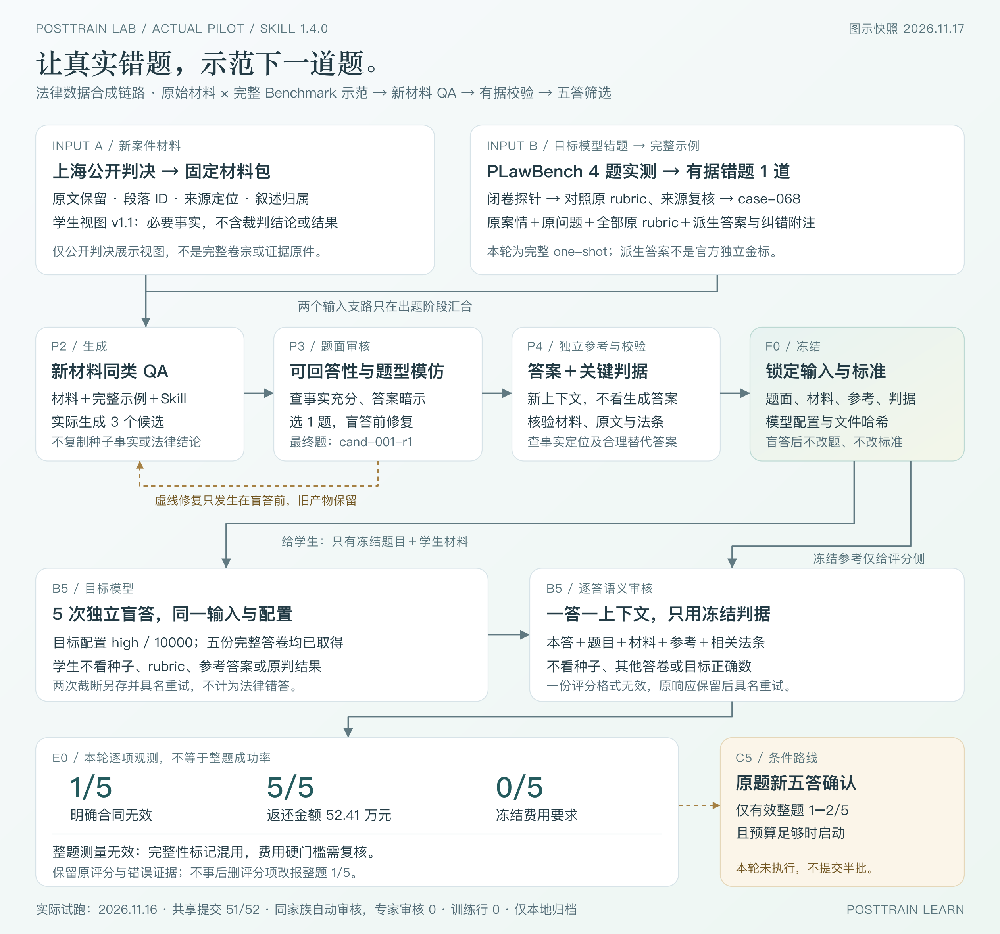

# 法律数据合成研究学习

以真实法律材料、可追溯的合成 Skill 和专家反馈为中心的本地研究工作台。借鉴 DataSeek 的浅色渐变、留白与数据卡片层次，但未复制平台素材、业务代码或内部接口。

## 运行

需要 Node.js 22 或更高版本。应用没有第三方运行时依赖，无需 npm install。

```bash
npm start
```

浏览器访问 `http://127.0.0.1:4317`。使用 `PORT=4320 npm start` 可更换端口。`npm run dev` 会在服务端源码变化时重启，前端文件修改后刷新浏览器。

本版是本机单用户应用，仅监听回环地址，拒绝其他 Host 和跨站写入。它不是带身份认证的多人协作服务，请勿直接暴露公网。专家标识为用户填写的审核记录，不是网站认证的法律专业资质。

## 功能

- 研究总览：真实资产数量、工作流程、本地模型结果线索和迭代记录。
- Skill 版本：完整快照、参考规范和脚本阅读；基于父版本修改文件，创建不可覆盖的新版本；逐行对比与文件指纹。
- 案例材料：马某与皮某民间借贷纠纷的脱敏展示视图、原文行号、来源链接及案件全景入口。
- 合成链路探索：12 个阶段的实际状态、输入/输出契约、准入门槛与 Skill 原始提示词；已试填案件包、全文整理稿、来源弹窗、双时间线、诉请沿革、证据/陈述/法院认定、争点、金额公式与缺口检查。
- Harbor Pilot 001：独立运行视图，展示来源审计、材料映射、实际 P1/P2/P3/P4/P6 调用、两次题面修复、三个结构种子、真实 VM 盲答、BoN、评分器正负控与发布阻断。原快照仍可单独访问。
- PLawBench：全部 280 道本地公开题目，搜索、任务/领域/用途筛选、分页、模型分歧排序、原始 rubric、模型回答和逐项评分证据。
- 专家联动：记录核验答案、简短依据、难度、推理结构与材料使用依据；关联 Skill 的反馈记录；用途隔离与批准种子导出。
- 本地研究备份：导出完整 Skill 快照、案件包、Schema、链路定义、真实合成运行及审核历史 JSON。备份含隐藏参考答案、提示词和可能的专家标识，需审查后共享，不可用于学生输入。

## 真实 Benchmark 引导试跑



链路图快照 `2026-11-17`：[可缩放 SVG](docs/images/benchmark-synthesis-pipeline-20261117.svg) · [Mermaid 结构源](docs/images/benchmark-synthesis-pipeline-20261117.mmd)。图示依据 `legal-benchmark-deepseek-20261116` 实际归档；逐项观测不等于有效整题成功率，虚线为盲答前修复或未执行的条件路线。

最新入口`/#exploration?run=legal-benchmark-deepseek-20261116`，协议与当前状态见`docs/benchmark-guided-pilot.md`。Skill 1.4.0采用真实目标错答、完整benchmark示例、新材料同类QA、独立参考、有据审核及冻结后五答的路径，不再使用旧20轮的三个自编结构示例。

本轮只核验通过1道开发种子（PLawBench `case-068`），所以是完整one-shot，不是多示例few-shot实验。原题与rubric不改，派生示例答案和法条补正来源单独标记，不能称官方独立金标。三个QA、一次题面修复、缺失事实认定补充及诉讼费参考纠错均保留历史。

已按用户批准的52次共享上限补齐五答及逐答评分，累计51/52次提交。逐项观测为本金5/5、明确合同无效1/5、费用项0/5；但评分器把法律覆盖遗漏与答卷完整性混用，且费用硬门槛需复核，首批测量无效，不宣称已合成成功的1-2/5高难样本，也不事后删除评分项改分。完整答卷、截断、评分失败、预算授权和测量复核均在平台分阶段展示。所有内容仅本地保存，专家审核0、训练行0；无zero-shot对照，不证明benchmark示例的因果收益。Astra限流记录及原20轮可独立追溯。

## 案件全景与链路版本

整案 Schema 设计在 `docs/case-dossier-v0.1.md`，机器可读基础结构在 `schemas/case-dossier-0.1.schema.json`。它记录多个程序、诉请版本、各方陈述、证据与阶段性认定，不把案件压成单一裁判摘要。案件包版本 `0.1.0` 与 Schema `0.1`、Skill `1.1.0`、material_pack `1.0`、训练样本契约 `1.1` 分开追溯；本次不覆盖历史 Skill。

本案底稿是 `content/dossiers/shanghai-2023-23060/0.1.0.extraction.json`。运行 `npm run dossier:build` 生成同目录下的 `0.1.0.json` 和 `casebook.md`；网页、JSON 下载与 Markdown 使用同一数据底稿。未来实质迭代应新增版本文件，不覆盖已发布的案件快照，并同步固定资源路由。

归档 `partial`、训练 `blocked`、专家 `not_reviewed` 是当前真实状态。只有一审公开判决书脱敏视图，没有证据原件或后续程序；证据提交者与证明关系为上下文归纳，非原始证据目录。原文中净利息自述与算术结果的差异原样保留为待核缺口。结构校验检查字段、有类型引用、冻结来源片段与定点金额公式，不认证法律真值、证据真实性或训练许可。

旧链路定义为 `content/pipelines/case-study-0.1.json`，固定引用 Skill `1.1.0`，作为未执行的研究快照保留。旧快照入口 `/#exploration?run=snapshot&stage=dossier`。它的4张争点卡和评测页模型快照不等于本轮合成结果。

## Harbor 完整试跑

新入口 `/#exploration?run=legal-harbor-001`。协议见 `docs/harbor-pilot-v0.1.md`，所有可展示产物在 `content/runs/legal-harbor-001/`。这是一个设计目标 D4 的原案封闭材料审计任务，难度需结合真实结果判断；未专家审核，正式训练发布仍受门槛约束。

原 Skill 不覆盖。P0确定性复用映射而非新模型抽取；P2使用3个自建假设规则结构示例，PLawBench 280题全部不交给生成器。P3两次发现问题并修复：分类规则不明确/标题提示，以及同段同额id定位不唯一。原题、旧输入和原审查响应都保留。最终学生文件排除了原裁判理由、主文和结果金额；研究者网页可以看答案，不代表学生代理能读取。

执行需要 Python 3.12、`harbor==0.25.0`、本机Smol环境及 Node 22+。可在独立 venv 安装 Harbor；本机使用同级 `harbor-ocr-demo/.venv` 的已安装环境，也可给评测脚本传 `--harbor /absolute/path/to/harbor`。VM缓存写入用户Library目录，受限环境可能需要运行许可。密钥只从 `LLMGW_OPENAI_API_KEY` 环境变量读取，不写入源码、VM、日志或网页。网关配置目前固定为已调通的模型服务；跨账号复现需自有授权和服务名适配。

```bash
# 阅读已归档实验无需模型密钥或Harbor，npm start即可。
# 新运行不要覆盖legal-harbor-001；应先创建新的run_id及版本化目录。
node scripts/fetch-pilot-laws.mjs
node scripts/pilot-prepare.mjs
node scripts/pilot-generate.mjs
# 本轮真实修复命令及历史已归档；不是所有新题都应机械做这两步。
node scripts/pilot-repair.mjs
node scripts/pilot-generate.mjs repair 1
node scripts/pilot-repair-locators.mjs
node scripts/pilot-generate.mjs repair 2
python scripts/pilot-controls.py
python scripts/pilot-evaluate.py --harbor /absolute/path/to/harbor
# 仅本轮第三次API超时后使用；前两次不重跑，失败保留，最多补跑一次。
python scripts/pilot-evaluate.py --harbor /absolute/path/to/harbor --retry-third-timeout
node scripts/pilot-generate.mjs audit
node scripts/pilot-finalize.mjs
```

代理是在真实 Harbor trial 内读取白名单文件、即时调用API、提交JSON的受限文件适配器，不是通用terminal agent。评分器运行在VM内；oracle、nop和盲答分别留痕，不能只用Harbor退出码判断成功。BoN用隐藏评分器取最大分，属于有金标选择上界，不是线上选择算法或总体pass@k。说明文字语义还需P6和专家核验，固定分数不能替代法律正确性。

原任务元数据的hard是冻结试跑时的设计目标，不代表已批准高难度。题面审查将其审定为D3；最终报告会同时列出目标、审定和经验结果，不覆盖原试跑文件来伪装历史。

本轮最终结果：1个任务、3份完成盲答均通过固定契约，1次无答案的网关超时另记；完成答案通过率3/3，包含超时的端到端成功率3/4。P3与P6均审定D3，未实现经验高难度。权限、隐私、完整材料规范化和污染审核仍未解决，专家审核为0，正式训练行数为0。Skill发布审计返回`empty_release`并阻止导出，真实结果归档于`release-gate-audit.json`，不是程序故障或通过认证。

12次网关请求包括10次成功阶段/盲答、1次成功连通预检和1次超时。已返回用量共176412 token（包含18 token预检）；超时实际用量与费用未知，没有继续调用模型。

## Bo5 自适应难度迭代

2026-11-15新实验入口`/#exploration?run=legal-bo5-20261115`，协议见`docs/bo5-iteration-protocol.md`。最多20轮，目标为同一题5份完成盲答中1–2份实质答对；命中后冻结题面，再跑新5答确认。旧三答实验不覆盖。每轮完整Skill快照从1.2.0递增，在合成前归档并实际加载。

每轮保存原因分析、材料包、结构种子选择、P1判断图、P2题目、P3充分性检查、P4有据答案、真实Harbor/Smol五答、P6逐答语义审计和结果。源代码生成的虚构衍生情景与原案严格区分；工程参考经过Decimal与独立Fraction复算，不称专家金标。失败、截断、格式和题目缺陷不能用于凑低成功率。所有题已用于自适应开发，训练导出保持隔离。

第1–4轮输出上限为10000 token；第4轮有一次明确因上限截断，失败原记录和同配置补答都保留。第5轮起上限提高为20000，模型、推理级别和总调用预算不变；每轮单独保存并冻结实际配置，网页按所选轮次显示，不将新旧配置混为严格对照。

`npm run hardness:run`可继续已有实验；会缓存完成调用、保留已提交失败，命中且确认后或达到20轮停止。新实验不得覆盖`content/campaigns/legal-bo5-20261115`。调用使用现有网关环境变量；请求预算与旧12次实验分开，价格未知。`npm run hardness:controls`检查独立复算和评分器错误注入，网页阅读无需密钥或Harbor。

实验结束后运行`npm run hardness:finalize`，独立重算五答计数、核对每轮冻结文件和逐答输入哈希，分别报告整题正确与法律状态字段正确数。数字算错属于实质错误，但仅此不能证明法律推理难。若材料门槛失败，保留为盲答前隔离，不算完成的Bo5轮次；已投递的模型调用不会取消或伪装成免费。

本次已在20轮上限停止：17轮取得完整五答，2轮材料问题在盲答前隔离，第15轮因本机合盖休眠、流式请求超时而没有完整答案。10轮难度测量有效，最低仍为4/5，未命中1–2/5，也未启动命中确认。法律判断在后续分层审计中仍均为5/5，错误主要是数值求值或计算依据，不能包装为高法律推理难度。原始无效测量及失败调用全部保留，第15轮不是0/5难题。

实际197次提交，183次完成；已知输入3633383、输出1277240 token，13次失败用量未知，另有1次失败返回了用量，费用未知。完整审计在`content/campaigns/legal-bo5-20261115/final-audit.json`，临时休眠恢复说明在`infrastructure-analysis.json`。无需密钥即可在网页查看跨轮次法律/金额/依据表及各阶段产物。

20份运行Skill快照1.2.0至1.2.19均保留，通用改进整理为1.3.0，附真实校准表和局限。该版强化材料充分性、无解题结论投影、种子隔离、阶段审核投影和实测门槛；不声称已证明开放命题器能自动找到高难题。专家审核和正式训练行仍为0。所有更新仅本地保存，不推送代码。

## 数据来源与口径

PLawBench 来源为 `https://github.com/SKYLENAGE-AI/PLawBench`，冻结提交 `f6ee07b36c1f4c0bfc2af8ca27183d3dd3175c56`。公开快照含案例分析 250、法律咨询 18、起诉状 6、答辩状 6，共 280 题，而非论文的完整 850 题。四份源 JSON/JSONL 原样保存并登记 SHA-256。

案例题没有独立 `answer/reference_answer` 字段。页面明确将源 rubric 中的参考结论与用户核验答案分开，不能凭 rubric 或模型高分宣称获得了法律金标。法律咨询与文书题没有独立 question 字段，页面显示的任务要求是任务标签说明，不冒充官方完整生成 Prompt。原始 score 字段也不是模型成绩。

PLawBench模型明细来自工作区已有实验 `ark-seed-judge-protocol-v4` 的只读快照，此部分不新调用模型：Lite 回答 280、评分 278；Pro 回答 280、评分 271；共同已评分 269 题。Harbor试跑是另一个真实运行，不混入这些成绩。对比用共同子集，各自已评分均值另外展示。裁判为 seed-2.1-pro，存在自评/家族偏差。内置上游 README 中 24 个模型的发布结果，但不与本地公开子集混成同一排名。

导入评测快照只保留回答、成绩、评分依据和必要来源元数据，不复制 API 凭证、端点配置、请求 ID 或 reasoningText。案例展示删除无关出生日期、居住信息、账户尾号和司法人员署名，保留法律事实、行为时间与金额；展示改动有明确记录，不冒充逐字原件。

## 种子与评测隔离

题目默认未分配。可标记种子候选、专家批准或保留评测。保留评测题不能直接成为种子；进入开发后的题不能重新声明为未见评测。批准需核验答案、简短依据、专家标识、使用依据和必要推理结构。系统校验字段和状态，不替代法律专家的实际审查。D3/D4 不能靠罗列普通查找与计算标签通过。

导出种子标记为 development，并记录原始题号、问题来源类型和审核信息。审核时的 Skill 版本固定保留，导出时的最新版本单独记录，不改写历史关联。若源基准的整体测试协议要求整组保留，应遵守该协议，而不是逐题挪用。材料许可、法域、适用时点和评测污染仍须独立核验。

## 存储与追溯

```text
public/                         网站前端，无外部 CDN
server.mjs                      Node.js HTTP API
lib/                            审核状态与原子落盘
content/skills/<version>/       可进入 Git 的完整 Skill 快照
content/skills/index.json       版本索引、父版本、说明与指纹
content/cases/                  脱敏案例及来源记录
content/dossiers/               版本化案件底稿、统一 JSON 与全文整理稿
content/pipelines/              链路定义及固定关联的 Skill 版本
content/runs/                   版本化Harbor试跑、提示词、模型响应与发布报告
harbor/tasks/                   学生环境、oracle方案与隐藏固定评分器
legal_harbor/                   受限文件模型代理，不覆盖已安装的harbor包
schemas/                        案件全景基础 JSON Schema
docs/                           Schema 设计说明
content/datasets/              PLawBench 浏览数据及原始公开文件
content/evaluations/           去除私密配置的已有模型结果
.local/research-state.json      专家记录与历史，默认不进 Git
private-source/                本地原件，默认不进 Git/源码包
test/                           领域、服务接口与持久化测试
scripts/                        快照检查、导入与源码打包
```

审核使用修订号检查防止覆盖过期记录，串行更新后原子替换 JSON。Skill 修改写入全新版本文件夹，保留父版本所有资源。当前没有自动备份恢复、跨设备同步、账号权限或网页启动付费调用功能；模型只由本地研究脚本显式调用。

首次 1.1.0 是从工作区真实 Skill 导入的站内快照编号，不是论文或原仓库官方版本；没有编造先前历史。样本契约 1.1 与 material_pack 1.0 为独立数据契约版本，不随文件快照号自动改变。

## 检查与打包

```bash
npm test
npm run check
npm run package
```

源码包生成在 `releases/legal-data-synthesis-lab-0.4.0.tar.gz`，附 SHA-256。它包含网站、公开数据快照、案件 Schema/整理稿/链路定义、Skill、Harbor任务、实验迭代产物及测试，不包含 `.git`、本地原件、专家运行记录、环境文件、依赖或私有VM日志。包可解压到独立目录后直接 `npm start`。

`npm run import:workspace` 是一次性的工作区导入工具，需要同级原材料与评测目录。已有内容快照时会拒绝运行，避免覆盖版本和研究历史。日常阅读、审核、运行、测试和打包均不依赖原工作区。

## GitHub 与公开边界

源码仓库：[xiaoxj372776076-cpu/PosttrainLearn](https://github.com/xiaoxj372776076-cpu/PosttrainLearn)。GitHub 用于源代码托管，不会自动运行本项目的 Node.js 服务；运行方式见上文。

用户要求每次更新先保存在本地，本轮不提交、不推送、不上传代码。研究产物可在本地网页和源码包追溯。

第三方材料的训练与再分发许可仍待核验，公开仓库或本项目的 MIT 许可不构成授权。请审查 `THIRD_PARTY_NOTICES.md`，以及审核/版本作者是否含不宜公开的个人信息。需要带上专家记录时，应先从站内导出并人工脱敏，不要直接取消 `.local` 的忽略规则。

应用自有代码的 MIT 许可不覆盖第三方法律材料、PLawBench 数据或模型实验内容，也不为其再分发提供授权。公开可读取不等于已确认训练或再分发条件。
