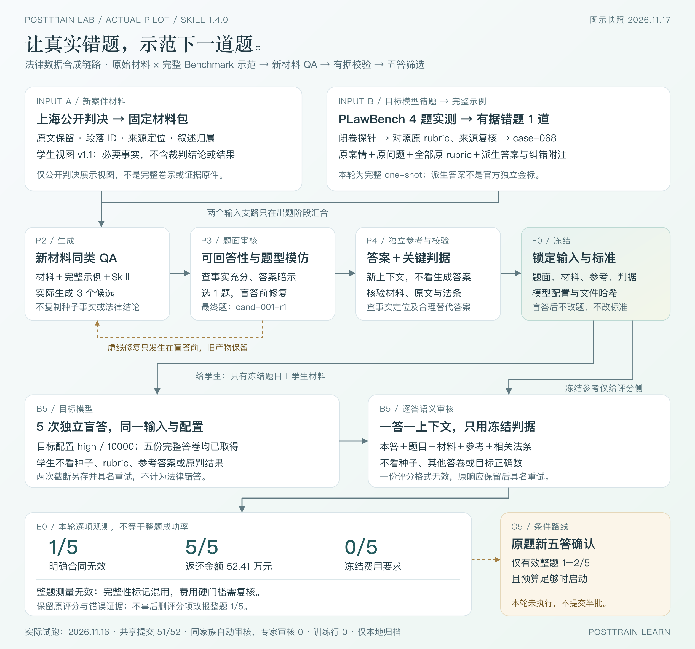

# 完整 Benchmark Few-Shot Pilot

运行目录：`content/runs/legal-benchmark-deepseek-20261116/`。Astra基础设施中断记录单独保留在`content/runs/legal-benchmark-20261116/`，不混入DeepSeek的错题、参考或盲答。旧20轮实验不改、不作为本次新题的难度证据。

目标链路：目标模型实测benchmark错题 -> 完整few-shot -> 新材料同类QA -> 有据校验 -> 五答筛选。Skill 1.4.0在首次筛查前归档，P2实际加载其模式说明和完整benchmark示例；保存请求及种子哈希，不用自编结构示例替代原题。



图示快照 `2026-11-17`：[SVG 矢量图](images/benchmark-synthesis-pipeline-20261117.svg) · [Mermaid 结构源](images/benchmark-synthesis-pipeline-20261117.mmd)。本图是实际试跑摘要，不代表完整卷宗取得、专家审核或高难度验收通过。

## 当前边界

- PLawBench本地公开快照。Astra筛查10题但基础设施中断；DeepSeek新筛查4题。原始案情、问题和rubric不改。
- 快照无独立答案字段，所选题的示例答案须单独重建并标记为rubric派生，不能冒充官方或专家答案。
- 原始上海借贷案件初版只使用公开判决中的程序、主张、证据提交及事实记载；去掉裁判理由与结果。第一次参考审核指出2.21万元资金来源事实认定缺失，修订材料视图1.1只补入`p-020`中该事实认定的精确片段`p-020-fact`，不加入合同无效结论、实际返还总额或判决主文。原材料与参考另存`*-before-repair.json`，原始来源不改。不用旧虚构情景构造器，不预设争点或答案字段。
- 新试验为闭卷案例分析，与benchmark的案情加问题形式一致。研究者的规范、参考、种子及评分不进入学生请求。
- 两个试验初始共享上限48次网关模型提交，包括诊断、失败及具名重试。在41次提交处因无法完成剩余整批而停止，用户明确批准扩展至52次；`submission-budget-amendment.json`保存授权、旧上限及原冻结哈希，Astra历史配置不变。3个QA候选，仅选择1题完成五答。首批有效命中且预算能完成全部五答及五次独立评分时，才可不改题面再确认。没有足够预算时不提交半批。
- Astra发生429及token限流。16000预算诊断答卷另存baseline，10000预算重测仅完成7/10后停止。DeepSeek目标请求为`deepseek-v4.1-1017/high/10000`，实际服务身份由响应单独保存；四道探针的实际身份为`deepseek-v4-1-flash-261017`。调用串行，DeepSeek间隔10秒，Astra120秒。
- DeepSeek辅助审查遇到网络失败和输出预算耗尽。失败独立保留；辅助重试、生成和参考采用同一模型家族的`medium/16000`。最终参考复审仍耗尽16000后，最后一次具名复审重试及逐答评分用`low/16000`，只提供实际用到的冻结法条。目标探针及盲答始终为`high/10000`，实际身份在冻结时登记，五答不一致则隔离。辅助配置不同不构成独立模型家族或专家审核。
- 种子资格分开记录“目标回答是否实质错误”与“示例核心答案是否有据”。初始`wrong_seed_candidate`字段出现语义歧义，原评分不覆盖；追加有来源复核独立保存。可补正引用、实质缺口、发布许可问题分别记录，不用关键词或目标数量自动判通过。
- `case-068`检索到法院公开案例说明，法条瑕疵及程序受理/实体胜诉区别另附补充审核；不是取得完整原审卷宗。`case-112`金额重算有缺口，暂不作为种子。若最终只选择1道有据错题，本次明确为one-shot，不宣称多示例few-shot效果。
- 三个初始候选中只推荐`cand-001`；首次参考因题面范围与隐藏事实依赖被拒绝。一次题面修复得到`cand-001-r1`，实际修复请求的完整seed和新材料也单独核验哈希。修订题仍有证据清单式提示，题面审核中明确保留此弱点。
- 自动参考复审曾认可强制标的比例分担及原案公告费结论；编码代理查询官方费用办法第12、29条后发现这不是唯一有据裁量，盲答前重新建立参考。旧冻结及旧标准保留于`*-before-reference-repair.json`。最终参考采用实际交付与无效返还、费用具体情况酌定；学生不要求猜原判精确费用。最终冻结才用于五答，提交任何盲答后禁止参考修复。
- 最终`preflight`核验必评分事实定位只来自学生视图、完整请求无种子/参考/rubric、模型配置及材料/规范/参考哈希一致。此项检查不是法律真值或证据真实性认证。
- 只报告同家族自动语义审核与原rubric对齐，不证明法律金标、泛化或训练收益。来源许可未核实，专家审核0，训练行0，不公开发布或推送。

## 分阶段执行

```bash
LEGAL_BENCHMARK_RUN_ID=legal-benchmark-deepseek-20261116 node scripts/benchmark-guided-pilot.mjs prepare
LEGAL_BENCHMARK_RUN_ID=legal-benchmark-deepseek-20261116 node scripts/benchmark-guided-pilot.mjs probe
LEGAL_BENCHMARK_RUN_ID=legal-benchmark-deepseek-20261116 node scripts/benchmark-guided-pilot.mjs score-probes
LEGAL_BENCHMARK_RUN_ID=legal-benchmark-deepseek-20261116 node scripts/benchmark-guided-pilot.mjs choose <已核验错题ID>
LEGAL_BENCHMARK_RUN_ID=legal-benchmark-deepseek-20261116 node scripts/benchmark-guided-pilot.mjs synthesize
LEGAL_BENCHMARK_RUN_ID=legal-benchmark-deepseek-20261116 node scripts/benchmark-guided-pilot.mjs freeze <已审查候选ID>
LEGAL_BENCHMARK_RUN_ID=legal-benchmark-deepseek-20261116 node scripts/benchmark-guided-pilot.mjs preflight
LEGAL_BENCHMARK_RUN_ID=legal-benchmark-deepseek-20261116 node scripts/benchmark-guided-pilot.mjs evaluate first
LEGAL_BENCHMARK_RUN_ID=legal-benchmark-deepseek-20261116 node scripts/benchmark-guided-pilot.mjs evaluate confirmation
LEGAL_BENCHMARK_RUN_ID=legal-benchmark-deepseek-20261116 node scripts/benchmark-guided-pilot.mjs finalize
```

`confirmation`在首批未有效命中或剩余预算不足时会拒绝执行。已提交但无完成响应的调用不能被同名自动重试；仅对已记录的终态失败使用具名重试，并保留失败、未知用量和新请求。`attempts-first.json`按槽位记录所有尝试，固定使用每个槽位首份完整响应，不能按答案好坏换答；已完成答卷和有效评分不重复提交。评分JSON解析或一致性校验失败另存`validation-error`，不能当作学生错答。没有可用实质错题时停止，不换成未测过的结构示例继续声称完成本链路。

本地平台入口：`/#exploration?run=legal-benchmark-deepseek-20261116`，原题、完整few-shot、候选、参考、冻结请求与评分按阶段展示。原始审查和追加复核并列追溯。未完成阶段不以模板代填。

本轮是直接API闭卷QA评测，不是Harbor terminal-agent评测，也不做工具检索或真实专家审查。没有zero-shot对照，不能将难度变化归因于使用了benchmark示例。

## 本轮状态

`completed_invalid_measurement`：4道新目标探针、1道有据开发种子、3个初始QA、1次盲答前题面修复及参考修正已归档。最终题为`cand-001-r1`，冻结和输入preflight通过。原中断报告另存`audit-report-before-continuation.json`。

用户批准52次共享上限后，第三、第四答的截断分别具名重试，原失败和已知用量保留。每槽位首份完整答卷固定采用，已有答卷不重复提交。第二份评分因返回非关键ID而校验失败，保留原响应和`validation-error`后具名重试，仅澄清JSON返回结构，不改冻结法律标准。最终五份完整答卷和五份通过结构核验的独立评分均已归档。

逐项观测：`C1-contract-invalid`为1/5通过，`C2-principal-actual-delivery`为5/5通过，`C3-fee-discretion`为0/5通过。全部冻结关键项同时通过0/5，但这不是有效法律正确率：第一、第二、第四份评分将法律覆盖遗漏标为`answer_complete=false`，第三、第五份类似遗漏却标为true；原门槛未通过，`correct=null`、`target_hit=false`。公告费细节作为整题硬门槛的关键性也需专家复核。不能事后删除费用项，把本轮改报为整题1/5。

`measurement-review.json`保存非专家研究复核和下一轮建议：分离API完整性与法律覆盖、盲答前审核critical门槛、区分题型模仿与错误机制迁移、扩充有据完整种子、减少题面解题提示。Skill 1.4.0、题面、材料和参考未因看到答卷而改写；建议尚未证明有效，也没有另启一轮合成。

DeepSeek本轮提交35次，API完成30次（含一份结构无效评分）、终态失败5次；两个试验合计51/52次提交。费用未知，已知token用量见`audit-report.json`。所有五份采用答卷的输入哈希均为`cfa434e45101c5acc6089073365a5667293ef0179553de2c39a20a10aeb803b0`，目标保持`deepseek-v4.1-1017/high/10000`，实际身份均为`deepseek-v4-1-flash-261017`。`evaluation-integrity-first.json`核对逐答输入与独立评分数据隔离，此项不是专家法律核验。

未执行确认批次：首批有效性门槛未通过，且只余1次提交不足完整五答及五评分。专家审核0、训练行0，不宣称高难度合成成功、稳定概率、泛化或训练收益。
